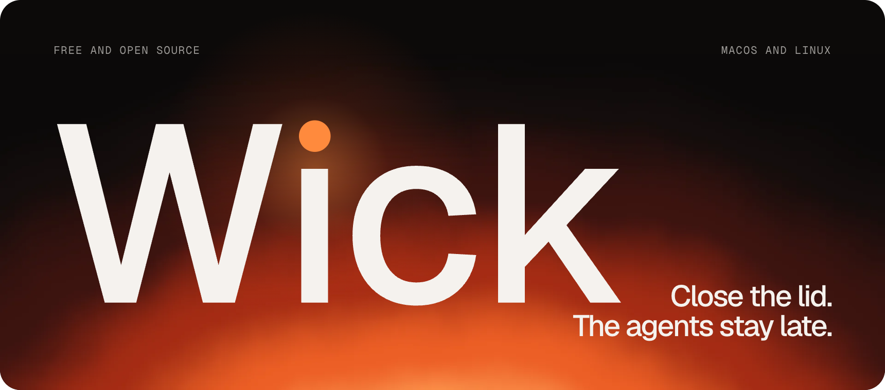
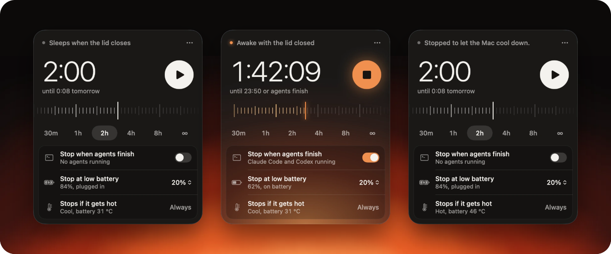

<p align="center">
  
</p>

<p align="center">
  <b>Keeps a Mac or Linux laptop awake with the lid closed, and always puts sleep back.</b>
</p>

<p align="center">
  <a href="https://s1lvazxy.github.io/wick/">Website</a> ·
  <a href="#install">Install</a> ·
  <a href="#use">Use</a> ·
  <a href="#what-stops-a-session">What stops it</a> ·
  <a href="brand/">Brand</a>
</p>

<p align="center">
  <a href="https://github.com/s1lvazxy/wick/releases/latest"></a>
  <a href="https://github.com/s1lvazxy/wick/actions/workflows/ci.yml"></a>
  
  <a href="LICENSE"></a>
</p>

<br>

Your laptop thinks a closed lid means bedtime. Your coding agent was mid-sentence.

Wick keeps the laptop awake with the lid shut, so coding agents, builds and downloads finish while you walk away. Then it puts sleep back. It also won't cook your laptop: if it runs hot with the lid closed for a minute, the session ends, and there's no switch for that.

<table>
  <tr>
    <td width="33%" valign="top"><b>One button</b><br>Pick how long, press play, close the lid. A menu bar app on macOS, a top bar extension or tray app on Linux.</td>
    <td width="33%" valign="top"><b>It knows who's on shift</b><br>Claude Code, Codex, Aider, OpenCode, Gemini CLI and six more. It can stop when the last one exits.</td>
    <td width="33%" valign="top"><b>It always puts sleep back</b><br>A guard outlives the app. Time, low battery, heat, quitting and logging out all end the session.</td>
  </tr>
</table>

## Install

### macOS

```sh
brew install --cask s1lvazxy/tap/wick
```

Or [download the zip](https://github.com/s1lvazxy/wick/releases/latest) and drag Wick to Applications. Early builds aren't notarised, so the first time, open **System Settings → Privacy & Security** and choose **Open Anyway**.

Needs macOS 14 or later. Runs on Apple silicon and Intel.

### Linux

```sh
pipx install "git+https://github.com/s1lvazxy/wick@v0.3.0#subdirectory=linux"
wick setup
```

`wick setup` checks that the lock is allowed, adds the app launcher and, on GNOME, adds the top bar extension. On GNOME, log out and back in once so it can load, unless setup says it's already enabled. There's also an RPM on the [releases page](https://github.com/s1lvazxy/wick/releases/latest).

Needs systemd-logind and Python 3.9 or later, so it works on Fedora, Ubuntu, Debian, Arch and most others. It doesn't work on distributions without systemd, like Alpine or Void. `wick doctor` tells you where your machine stands.

On desktops other than GNOME, `wick app` runs a panel and a tray icon. That needs a few system packages, which it lists if they're missing.


## Use

Click the mark in your menu bar or top bar, pick a duration, press play, close the lid. On a Mac, the first time, macOS asks for your password once (see [Permission](#permission)). Linux needs no password.

<p align="center">
  
</p>

From the terminal:

```sh
wick on 2h              # stay awake for two hours
wick on                 # until `wick off`
wick on --agents        # until your coding agents finish
wick on 8h --floor 30   # stop at 30% battery instead of 20%
wick run claude         # stay awake while one command runs
wick off                # back to normal
wick status             # what's going on, heat included
wick agents             # which agents Wick can see
```

## What stops a session

| Trigger | Behaviour |
| --- | --- |
| Time runs out | Enforced by a separate process, so it still happens if the app crashes or the terminal closes. A command under `wick run` holds it open until it exits |
| Battery floor | 20% by default, only while on battery. Change it or turn it off |
| Critical heat | Lid open or closed. macOS reports a critical thermal state, or on Linux a sensor stays within 3°C of its critical trip point for 30 seconds (1°C for hwmon sensors such as the CPU's own). Always on |
| Heat with the lid closed | From 0.3.0. Sooner, because a closed laptop can't shed heat through its keyboard. For 60 seconds straight: macOS reports a serious thermal state, or the battery is at 45°C or more. On Linux: the battery is at 45°C or more, a thermal zone is within 8°C of its critical trip point, or an hwmon sensor is within 5°C of its limit. One cooler reading starts the minute again. Only when the lid is known to be closed. Always on |
| Agents finish | Optional. 90 seconds after the last one exits. An agent left open at its prompt still counts as running |
| The command exits | For `wick run`, including if `wick run` itself is killed |
| Quit, log out, shut down | Sleep comes back |
| Someone else changes it | Wick notices and lets go |

A guard force-killed with `SIGKILL` can't clean up after itself, so a small launchd job (`~/Library/LaunchAgents/io.github.s1lvazxy.wick.guard.plist`) runs the guard at login and every five minutes. It exits at once unless a session needs enforcing. macOS lists it under Login Items as `wick`.

> [!WARNING]
> Keep it out of bags while it's awake. A closed laptop sheds heat slowly. Wick can end a session, but it can't air-condition a backpack.

## Permission

### macOS

Changing this setting needs root. Wick adds one file, `/etc/sudoers.d/wick`, after checking it with `visudo`:

```
you ALL=(root) NOPASSWD: /usr/bin/pmset -a disablesleep 0, /usr/bin/pmset -a disablesleep 1
```

It allows those two exact commands and nothing else. The trade-off: any process running as you can also flip this setting without a password. It can't do anything else with the rule, but it could keep your Mac awake.

A sudoers rule rather than a privileged helper because it needs no Apple Developer ID, and you can read all of it in one line. `wick uninstall` removes it, along with the launchd job. `brew uninstall --cask wick` keeps the rule, since Homebrew runs the same steps on every upgrade and an upgrade shouldn't cost a password prompt, so run `wick uninstall` first, or use `brew uninstall --zap --cask wick`.

### Linux

Nothing to install and no root. Wick holds a `handle-lid-switch:sleep:idle` inhibitor lock from systemd-logind, through its guard process, and if that process dies for any reason the lock goes with it within a couple of seconds, so a crash can't leave the laptop stuck awake.

logind only hands out this lock to an active local session, so `wick on` fails over SSH, from cron or from a system service, and says so rather than pretending. `wick doctor` prints the polkit rule that widens it, if you want that.

## Why not caffeinate?

`caffeinate` stops idle sleep, but closing the lid still puts the Mac to sleep. Only `disablesleep` survives that. On Linux, the equivalent trap is a `sleep` inhibitor, which logind ignores for the lid by default. It takes `handle-lid-switch`.

## How it's built

The macOS app is Swift 6, SwiftUI and AppKit, with no dependencies, at 5 MB. The Linux side is Python with no dependencies beyond systemd, in [linux/](linux). Both use the same session model and rules. Neither makes a network request.

```
Sources/WickCore        the setting, sessions, the guard, heat, agent detection, the sudoers rule
Sources/wick            the CLI, which is also the guard process
Sources/WickUI          the panel, the ruler, the menu bar item
Sources/WickApp         the app's entry point
Sources/wick-snapshots  renders every panel state to PNG
linux/                  the Linux CLI, guard, tray app, GNOME extension and their tests
brand/                  the identity: logo, icon, imagery, the brand book, and the scripts that make them
site/                   the landing page (Vite, three.js, GSAP)
packaging/              the Homebrew cask and the npm installer
```

The session file in `~/Library/Application Support/Wick` is the single source of truth. The app and the CLI write it, and the guard enforces it.

<details>
<summary><b>Building and testing</b></summary>

```sh
swift test             # unit tests
scripts/e2e.sh         # drives the CLI and guard against a simulated setting, no root needed
scripts/build-app.sh   # builds dist/Wick.app and a zip. Needs Xcode 26 for the icon

cd linux
python3 -m unittest discover tests   # unit tests
tests/e2e.sh                         # CLI and guard against a simulated lock
tests/logind/run.sh                  # real systemd-logind and a virtual lid switch, in containers. Needs Docker
tests/gnome/run.sh                   # loads the extension in real GNOME Shell releases. Needs Docker
preview/run.sh                       # a real GNOME desktop with Wick in it, in your browser. Needs Docker
```

</details>

<details>
<summary><b>Releasing</b></summary>

Run `linux/tests/logind/run.sh fedora:42 fedora:latest ubuntu:22.04 ubuntu:24.04 debian:12 debian:13` and `linux/tests/gnome/run.sh` first, because CI can't: they need a privileged container with systemd as PID 1. Then push a tag like `v0.3.0`. [`release.yml`](.github/workflows/release.yml) builds, publishes to GitHub Releases, updates the tap and publishes to npm. Its header lists the secrets, all optional. With a Developer ID it also signs and notarises, after which the cask's quarantine step can go and Wick can apply to the official Homebrew cask list.

</details>

## Credits

The Linux port was started by [gust330](https://github.com/gust330) in [wick-linux](https://github.com/gust330/wick-linux).

## License

[MIT](LICENSE). The Wick name and logo are in [brand/](brand), with the [brand book](brand/wick-brand-book.pdf).
