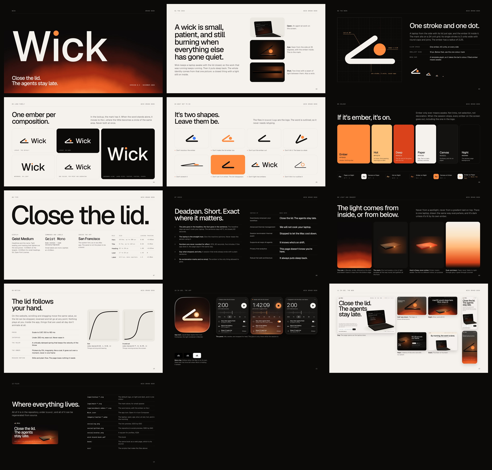

# Wick brand



The whole identity is in [wick-brand-book.pdf](wick-brand-book.pdf). This page is the same thing as text, for copying values out of.

## The idea

A candle's wick is small, patient, and still burning when everything else has gone quiet. Wick keeps a laptop awake with the lid closed, so the picture behind everything is a closed thing with a light still on inside.

The mark is a laptop seen from the side with its lid just ajar, and the ember lit inside it. Shut, it becomes two lines with a seam of light between them, which is also a wick. On the website you can scroll the 3D laptop into exactly that side view.

**Tagline:** Close the lid. The agents stay late.

**In one plain sentence:** Wick keeps a Mac or Linux laptop awake with the lid closed, and always puts sleep back.

## Logo

| File | Use |
| --- | --- |
| `logo/lockup-dark.svg`, `lockup-light.svg` | The default, on light and dark |
| `logo/lockup-mono-dark.svg`, `lockup-mono-light.svg` | Where only one colour is possible |
| `logo/mark-dark.svg`, `mark-light.svg`, `mark-mono.svg` | Small spaces |
| `logo/wordmark-ember-dark.svg`, `wordmark-ember-light.svg` | The word alone, at large sizes: footers, posters, covers |
| `logo/wordmark-dark.svg`, `wordmark-light.svg` | The plain word, for when something else on the page already carries the ember |
| `Wick.icon` | The app icon. Open it in Icon Composer |

The mark sits on a 24 unit grid. Its one stroke is 2 units wide, with round caps and joins, and the ember has a radius of 2.25. Keep clear space of one ember, 4.5 units, around it. Below 16px, use the mono version.

**One ember per composition.** In the lockup, the mark has it. When the word stands alone, it moves to the i, where the square tittle becomes a circle of the same area. Never both at once.

Don't recolour the ember, colour the lid, remove the ember, tilt the mark, stretch it, set it on an ember background, or outline it. The word is outlined in the files, so never retype it.

## Colour

| Name | Hex | Role |
| --- | --- | --- |
| Ember | `#FF8A3D` | Awake. Nothing else |
| Hot | `#FFC27A` | Lit ticks, time passing, warnings on dark |
| Deep | `#D9421A` | The far end of the glow, and too hot |
| Paper | `#F5F2EE` | Day. Text on dark, primary controls |
| Canvas | `#141211` | Surfaces, and ink on paper |
| Night | `#0C0A09` | The darkest page background |

The rule that holds it together: **if it's ember, it's on.** Ember isn't for links, selection or decoration. When a session stops, every ember on screen goes out, including the one in the logo in the website's navigation.

Heat is not ember. A laptop that's too hot is shown in Hot and then Deep, so "awake" and "too hot" never look the same.

| Pair | Contrast |
| --- | --- |
| Paper on Night | 17.7 : 1 |
| Canvas on Paper | 16.7 : 1 |
| Hot on Night | 12.5 : 1 |
| Ember on Night | 8.4 : 1 |
| Canvas on Ember | 8.0 : 1 |
| Ember on Paper | 2.1 : 1. Never for text |

## Type

- **Geist Medium** (SIL Open Font License) for the name and for headlines.
- **Geist Mono** for commands, and for small labels in capitals at +0.06em.
- **San Francisco** inside the app, as on any Mac app.

| Role | Size | Leading | Tracking |
| --- | --- | --- | --- |
| Hero | 10.6vw, up to 208px | 0.88 | -0.058em |
| Title | 6.7vw, up to 118px | 0.94 | -0.05em |
| Heading | 22 to 30px | 1.08 | -0.035em |
| Lead | 17 to 22px | 1.42 | 0 |
| Label | 12.5px, mono capitals | 1.5 | +0.06em |

Tracking tightens as the size grows. One value for every size is wrong somewhere.

## Voice

Deadpan, short, and exact where it matters.

1. **The joke goes in the headline, the fact goes in the sentence.** The headline says we won't cook your laptop. The sentence says 45°C, lid closed, 60 seconds.
2. **The laptop is the straight man.** Give the machine opinions. Never tease the person using it.
3. **Numbers are never rounded for effect.** 20%, 90 seconds, five minutes. If the app does it, the page says it the same way.
4. **Say what stopped, and why.** A session that ends always ends with a plain sentence.
5. **No exclamation marks and no emoji.** The ember is the only thing allowed to glow.

| Instead of | Wick says |
| --- | --- |
| Seamlessly empower your workflow | Close the lid. The agents stay late. |
| Advanced thermal management | We will not cook your laptop. |
| Session terminated: thermal event | Stopped to let the Mac cool down. |
| Supports all major AI agents | It knows who's on shift. |
| Privacy first analytics | This page doesn't know you're here. |
| Robust fail safe architecture | It always puts sleep back. |

## Light and imagery

The light comes from inside, or from below. Never from a spotlight, and never from a gradient laid on top.

- **The coal.** A Blender render, not a CSS gradient: a coal below the frame, warped with noise, with a dithered 16-bit ramp so the dark end doesn't band. It rises from the bottom edge, as the panel, the icon and the site do.
- **The seam.** Shut and awake, a line of light escapes all the way round the laptop and gathers at the front edge.
- **The laptop.** There is one, drawn the same way everywhere. `imagery/` has it open, ajar, shut, at rest, hot, and in the morning, with transparent backgrounds. They're stills from the website's own 3D scene.
- **Dusk and dawn.** Paper never fades to night through grey. It goes through a sunset.

## Motion

- The lid follows your hand. On the website, scrolling and dragging move the same value, so the lid can be stopped, reversed and let go at any point.
- Inside the app, things that are used all day don't animate at all.
- Press: scale to 0.97, 100 to 160ms. Interface: under 250ms, ease out. Never ease in.
- `cubic-bezier(0.23, 1, 0.32, 1)` for things arriving and leaving, `cubic-bezier(0.77, 0, 0.175, 1)` for things moving across the screen.
- The ruler is a critically damped spring that keeps the velocity of the throw.
- The ember flickers by 5%, irregularly, like a coal. It goes out over a moment, never in one frame.
- With reduced motion, the website becomes stills and plain flow, and loses nothing it needs.

## Social

| File | Use |
| --- | --- |
| `social/og.png` | Link preview, 1200 by 630. The website's copy is `site/public/og.png` |
| `social/github.png` | The repository's social preview, 1280 by 640. Upload it under Settings, Social preview |
| `social/avatar.png` | A square for profiles, 1024 |
| `../docs/hero.png`, `../docs/panel.png` | The pictures in the main README |

## Regenerating

```sh
Blender -b -P brand/src/render.py -- <out> 128             # glow.png and coal.png
python3 brand/src/layers.py <out>                          # the mark's layers for Wick.icon
python3 brand/src/lockup.py Geist-Medium.ttf brand/logo    # the mark, the lockups and the word
python3 brand/src/wordmark.py brand/logo                   # the other wordmarks, from the word already set
swift run wick-snapshots <snapshots>                       # the panel, in every state
python3 brand/src/site_shots.py <snapshots> site/public    # the panel pictures on the website
python3 brand/src/imagery.py <captures> brand/imagery site/public
brand/src/render.sh                                        # the book, the overview above, and the social images
```

`lockup.py` needs the exact Geist Medium the logo was first set in, from the `geist` package on npm. A different release of the font draws slightly different letters, which is why `wordmark.py` works from the outlines already in `logo/` instead of setting the word again.

The captures for `imagery.py` come from the website: run its dev server, open it with `?capture` on the end of the address, and call `wickCapture(pose, width, height)` from the console. The poses are in `site/src/main.ts`.

`render.sh` needs Chrome and Pillow. The book's source is `book/index.html`, and the social images are `book/social.html`.
